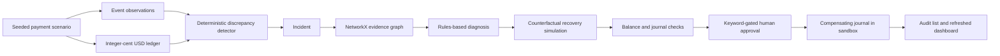

# LedgerLens system design: one-page guide

## What it does

LedgerLens is a local, simulation-only incident review application. It creates payment events and internal journal records, detects a duplicate capture posting, shows connected evidence, and lets a user simulate and approve a compensating entry in an in-memory ledger. It does not call a real payment provider or move funds. The investigator is deterministic Python rules today; there is no LLM integration.

## Main path



## Components

- **Financial core** (`apps/api/src/ledgerlens/core.py`): account and payment types, integer minor-unit journals, per-currency balance checks, idempotency conflict detection, reversals, incident detector, evidence graph, deterministic diagnosis, and recovery simulation.
- **Scenario and API** (`apps/api/src/ledgerlens/api.py`): a seeded duplicate-posting demo and FastAPI routes for health, keyword check, incidents, evidence, investigation, recovery, overview, and audit. Data lives in module-level Python objects and resets when the process restarts.
- **Web app** (`apps/dashboard/app/`): Next.js landing page, local Sora font, incident charts, event graph, simulation/approval UI, and audit summary. It reads the API; the current keyword only hides or reveals the web workspace. API endpoints are not authenticated.
- **Scorecard** (`benchmarks/scorecard.py`): generated fault and control cases measured against the deterministic baseline. Outputs percentages, counts, CSV, and JSON. It is a narrow smoke score, not FinOpsBench or an LLM evaluation.

## Trust and consistency boundaries

Money is represented as integer USD cents. A posted journal has equal debits and credits and is not edited; correction is a new opposite-side journal. External payment events are observations and do not create a bank-cash asset. Evidence graph edges have provenance; timestamp order is not treated as causality. No model has write access because no model integration exists.

Recovery first deep-copies the in-memory ledger, applies a proposed reversal to the copy, and checks balance effects. A separate keyword check is required before the sandbox ledger changes. The API rechecks the ledger version before execution and writes a process-local audit event. This is a demonstration workflow, not durable transactional storage or production authorization.

## Run and test

```text
uv sync --extra dev
cd apps/dashboard && npm ci
make test
make benchmark
docker compose up --build
```

The benchmark can also be run without GNU Make: `uv run python benchmarks/scorecard.py --cases 50 --seed 73`.

The API is on port 8000 and the dashboard on port 3000. See `docs/DEMO.md` for the sample path. Docker runtime has not been verified in this environment.

## Current limits

There is one payment fault family, process-local state, no SQL migrations, no cross-process concurrency control, no real provider, no LLM investigator, and no production auth. The score varies seeds and amounts around one fault family; report its percentage with that scope and do not describe it as generalized payment diagnosis accuracy.
